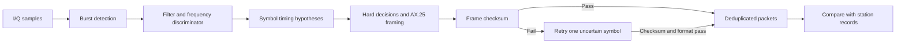

# Sideband

**Confidence-based symbol retries raised verified recovery from 36 to 40 packet occurrences across six held-out RSP-03 passes.**

Sideband replays public satellite I/Q recordings and measures which receiver changes recover more telemetry. The benchmark uses the RSP-03 9.6 kbaud GMSK downlink recorded by the Dwingeloo radio telescope.

Selective frequency retry recovered the same 40 and added 61% to replay time over the confidence receiver. All three modes used the same symbol timing. The receiver uses conventional signal processing.

| Receiver mode | Verified packets | Local replay time |
| --- | ---: | ---: |
| Hard decisions | 36 | 70.7 s |
| Confidence retry | 40 | 110.0 s |
| Confidence + selective frequency retry | 40 | 176.9 s |

[Benchmark report](RSP03-final.md) · [24-second demo](results/Sideband-demo.mp4) · [Per-pass results](results/rsp03-final-passes.csv)

A follow-up optimization reduced median serial confidence replay from **111.05 s to 68.40 s (1.62×)** with identical packets and timestamps. [Speed benchmark](RSP03-speed.md)

## Quickstart

With Python 3.12 or 3.13, run from the project directory:

```sh
python3 -m venv .venv
source .venv/bin/activate
python -m pip install numpy==2.1.3 scipy==1.15.3
python quickstart.py
```

Expected first line:

```text
Synthetic AX.25 packet at 2.026 s: Sideband synthetic packet
```

The quickstart generates ten seconds of synthetic I/Q in memory and runs it through the receiver. It requires no radio, capture download, or station reference data.

## Receiver chain



The optional frequency mode adds a corrected decode on selected bursts and keeps the original zero-shift output. The quickstart checks against a known synthetic payload. The real benchmark scores against available station records after decoding.

## Reproduce the benchmark

From this directory on an Apple Silicon Mac with Python 3.12 or later:

```sh
python3 -m venv .venv
source .venv/bin/activate
python -m pip install numpy==2.1.3 scipy==1.15.3
python fetch-rsp03-final.py
python -B benchmark-rsp03-final.py --output replays/rsp03/final-run
python summarize-rsp03-final.py replays/rsp03/final-run
```

The fetch step downloads about 1.4 GiB of I/Q and verifies every file against the [recording manifest](results/rsp03-final-manifest.csv). The benchmark checks the frozen receiver source hashes and obtains SatNOGS reference payloads for scoring after decoding. The run directory contains per-recording checkpoints, packet and timing CSVs, and the aggregated pass table. Use a fresh output directory to repeat the measurements.

The packet counts reflect byte-for-byte matches with available station records, with paired polarization receptions deduplicated at pass level. Timings are local replay measurements from one run per mode and recording. The report describes the matching and timing boundaries.

## Script guide

| Task | Script |
| --- | --- |
| Decode a synthetic burst | `quickstart.py` |
| Detect bursts in I/Q | `replay-rsp03-tracking.py` |
| Apply symbol timing, confidence retry and optional frequency correction | `replay-rsp03-confidence.py` |
| Decode AX.25 frames and validate checksums | `replay-rsp03.py` |
| Fetch captures and run the held-out comparison | `fetch-rsp03-final.py`, `benchmark-rsp03-final.py` |
| Summarize, verify and plot benchmark results | `summarize-rsp03-final.py`, `verify-rsp03-final.py`, `plot-rsp03-final.py` |
| Inspect development experiments | See the [development log](RSP03.md) for the `check-*`, `diagnose-*`, and experimental replay scripts. |

Run the local test suite with `python -m unittest discover -s tests -v`. GitHub Actions runs the same tests and quickstart on pushes and pull requests.

## Receiver development

- [Development log and feasibility checks](RSP03.md)
- [Confidence-based decoding](RSP03-confidence.md)
- [Symbol-level frequency estimates](RSP03-symbol-levels.md)
- [Selective frequency retry](RSP03-selective.md)
- [Development-pass runtime comparison](RSP03-runtime.md)

## Optional FUNcube-1 smoke test

The documented FUNcube-1 sample recovered one 256-byte frame on Apple Silicon using GNU Radio 3.10.12.0 and gr-satellites 5.9.0. With Conda installed:

```sh
conda create --prefix ./.radio --override-channels -c conda-forge \
  python=3.12.16 gnuradio-core=3.10.12.0 gnuradio-satellites=5.9.0
conda activate ./.radio
./replay-funcube.sh
```

The script downloads and checks the WAV, disables telemetry submission, and saves the decoder log and KISS frame locally.

## Data credit

The I/Q recordings are from the [CAMRAS Dwingeloo SatNOGS archive](https://data.camras.nl/satnogs/), which distributes them under CC BY 4.0. Observation and reference links are available through the [recording manifest](results/rsp03-final-manifest.csv).
